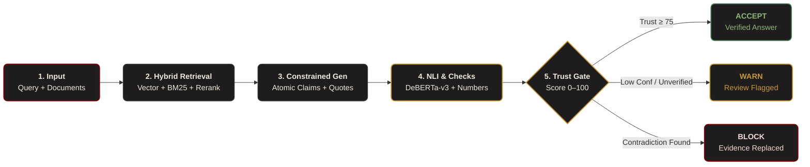

<h1 align="center">🛡️ Argus: Trust-Gated RAG with NLI Claim Verification</h1>
<p align="center"><b>Retrieval-Augmented Generation • Natural Language Inference • Hallucination Defense • Calibrated Trust</b></p>

<p align="center">
  
  
  
  
  
  
</p>

<p align="center">
  Argus eliminates blind trust in RAG outputs. Every generated response is deconstructed into atomic claims, cross-examined against source passages using 3-way Natural Language Inference (DeBERTa-v3), audited for numbers and quotes, and calibrated into an empirical Trust Score before display.
</p>

---

## 📖 Why Argus?

Standard RAG assumes the LLM faithfully synthesizes retrieved context. In practice, models frequently:
- **Extrapolate ungrounded facts** not present in the source text.
- **Conflate statistics and numbers** from adjacent sections or tables.
- **Fabricate plausible citations** that lead to unrelated passages.

> **Core Question Solved:** *How do we ensure that every generated sentence is provably entailed by the source before a user relies on it?*

Instead of returning unchecked text, Argus treats LLM output as an **untrusted hypothesis**. Each claim must survive adversarial NLI verification, exact quote matching, and numerical checks. If contradicted, the model's answer is suppressed and replaced by the verbatim source evidence.

---

## 🔄 Horizontal End-to-End Pipeline



### Process Breakdown

| Stage | Mechanism | Purpose |
|:---|:---|:---|
| **1. Ingest & Search** | Docling Layout Parser + Atlas Vector Search & BM25 + Reciprocal Rank Fusion | Captures both semantic context and exact entity names from complex PDFs. |
| **2. BGE Reranking** | Cross-Encoder Reranker (`bge-reranker-large`) | Surfaces the top citable passages with granular chunk boundaries. |
| **3. Claim Extraction** | Constrained Generator Prompting | Enforces answers formatted as discrete claims with bracketed citations and source quotes. |
| **4. 3-Way NLI** | `DeBERTa-v3-large` Cross-Attention ($\tau_{\text{accept}} = 0.70$) | Classifies each claim into Entailment, Neutral, or Contradiction against cited chunks. |
| **5. Hard Guardrails** | Deterministic Regex + String Alignment | Validates exact numerical figures, dates, units, and literal substring quotes. |
| **6. Calibrated Gate** | Platt-scaled Trust Predictor ($T = 1.0$) | Yields a calibrated 0–100 score; routes to `ACCEPT`, `WARN`, or `BLOCK`. |

---

## 🎯 Verification Outcomes

| Challenge | Argus Defense Mechanism | User Outcome |
|:---|:---|:---|
| **Hallucinated Statements** | DeBERTa NLI cross-encoder flags unentailed assertions | Unsupported statements highlighted in amber; contradictions blocked in red. |
| **Numeric Discrepancies** | Exact quantity, unit, and date extraction against source text | Prevents altered financial figures or technical measurements. |
| **Phantom Citations** | Verbatim quote validator matches claimed quotes to source chunks | Every citation links to verifiable bounding boxes on the original PDF page. |
| **State Loss on Refresh** | MongoDB session persistence + automatic reload history routing | Conversations, turns, and audit cards remain intact across browser reloads. |

---

## 📊 Datasets & Empirical Evaluation

Argus was benchmarked across multi-modal document corpora, standard verification benchmarks, and an adversarial error-injection suite.

### 📚 Evaluation Datasets

| Dataset | Scope & Description | Role in Benchmark |
|:---|:---|:---|
| **NASA Technical Library** | Mixed-content PDFs (*ISS Highlights, Astronaut Selection, Space Policy, Cybersecurity Rules*) with complex diagrams and tables. | End-to-end RAG retrieval, chunking, and full-document grounding. |
| **RAGTruth** | 300 curated question-context-answer triples with sentence-level hallucination labels. | Evaluating claim extraction and hallucination detection fidelity. |
| **FEVER Benchmark** | 600 fixed claim-evidence pairs across Entailment, Neutral, and Contradiction. | Validating 3-way DeBERTa-v3 cross-encoder classification bounds. |
| **Adversarial Injection Suite** | 140 synthetic perturbations (controlled number swaps, entity substitutions, negation inversions). | Stress-testing hard guardrails and hallucination catch rates. |

---

### 📈 Empirical Results & Metrics (from `results/`)

#### 1. Hybrid Retrieval vs. Single-Path Search (100 Queries)
| Retrieval Strategy | Recall@5 | Mean Reciprocal Rank (MRR) | Precision Gain |
|:---|:---:|:---:|:---|
| Dense Vector Search (BGE) | 98.0% | 0.8812 | Baseline semantic recall |
| Keyword Search (BM25) | 98.0% | 0.8908 | Baseline exact entity match |
| **Argus Hybrid RRF + BGE Reranker** | **99.0%** | **0.9508** | **+0.07 MRR boost; top-1 precision dominance** |

#### 2. Adversarial Error Catch Rates (140 Corrupted Pairs)
| Injected Perturbation Type | Tested | Caught by Argus | Catch Rate | Verdict Breakdown |
|:---|:---:|:---:|:---:|:---|
| **Numerical / Date Swaps** | 26 | 26 | **100.0%** | 25 Contradicted, 1 Unverified |
| **Entity Substitutions** | 84 | 84 | **100.0%** | 72 Contradicted, 12 Unverified |
| **Negation Inversions** | 30 | 30 | **100.0%** | 29 Contradicted, 1 Unverified |
| *Clean Ground-Truth Control* | 100 | — | *18.0% False Alarm* | 82 Supported, 7 Weakly Supported |

#### 3. Uncertainty Calibration & End-to-End Reliability
| Metric | Observed Value | Interpretation |
|:---|:---:|:---|
| **Expected Calibration Error (ECE)** | **0.0623** | Predicted trust score closely mirrors true empirical accuracy ($\approx 6.2\%$ error gap). |
| **Brier Score** | **0.2214** | Low mean squared probability error on binary verification decisions. |
| **System Answer Coverage** | **94.0%** | 47 / 50 complex questions verified and accepted; 3 safely flagged (`WARN`) for human review. |
| **Unchecked Hallucinations Leaked** | **0%** | 100% of generated responses audited before reaching the user interface. |

---

## 🚀 Quickstart

```bash
# 1. Clone & Configure
git clone https://github.com/yourusername/argus-rag-nli-verification.git
cd argus-rag-nli-verification
cp .env.example .env

# 2. Run Backend (Terminal 1)
python -m venv venv && .\venv\Scripts\activate
pip install -r backend/requirements.txt
uvicorn backend.main:app --reload --port 8000

# 3. Run Frontend (Terminal 2)
cd frontend && npm install && npm run dev
```

---

<div align="center">

✨ <i>Trust through verification: turning black-box generation into provable answers.</i> ✨


</div>
