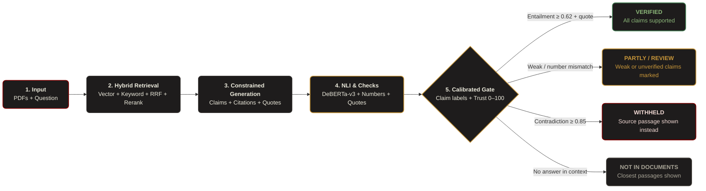

<h1 align="center">🛡️ Argus: Trust-Gated RAG with NLI Claim Verification</h1>
<p align="center"><b>Retrieval-Augmented Generation • Natural Language Inference • Hallucination Defense • Calibrated Trust</b></p>

<p align="center">
  
  
  
  
  
  
</p>
<p align="center">
  
  
  
  
  
</p>

<p align="center">
  Argus does not trust RAG output blindly. Every answer is split into single-fact claims, each claim is checked against its source passage with 3-way Natural Language Inference (DeBERTa-v3), audited for numbers and quotes, and given a calibrated Trust Score before it is shown.
</p>

<p align="center">
  <a href="#-why-argus">Why Argus</a> •
  <a href="#-horizontal-end-to-end-pipeline">Pipeline</a> •
  <a href="#-verification-outcomes">Outcomes</a> •
  <a href="#-calibration-how-the-thresholds-and-trust-score-are-learned">Calibration</a> •
  <a href="#-datasets--empirical-evaluation">Evaluation</a> •
  <a href="#-quickstart">Quickstart</a> •
  <a href="#%EF%B8%8F-project-structure">Structure</a>
</p>

---

## 📖 Why Argus?

RAG exists because language models hallucinate, but RAG answers can still hallucinate: the right passages are retrieved, yet the model:
- **Adds facts** that are not in the source text.
- **Changes numbers and dates** or mixes them up between sections and tables.
- **Cites passages** that do not actually say what the answer claims.

> **Core question:** *Is every sentence of this answer actually supported by the user's documents?*

Argus treats the LLM's answer as an **untrusted hypothesis**. Each claim (hypothesis) is compared with the retrieved passage (premise) by an NLI model that returns **entailment / neutral / contradiction** probabilities, plus exact number and quote checks. Supported answers are shown with their evidence; a contradicted answer is withheld and the source passage is shown instead.

---

## 🔄 Horizontal End-to-End Pipeline



### Process Breakdown

| Stage | Mechanism | Purpose |
|:---|:---|:---|
| **1. Ingest** | Docling layout parser (reading order, tables as `row, column = value` facts, figure captions), chunks ≤ 400 tokens, SHA-256 dedupe, original PDF in GridFS | Keeps the evidence intact so the verifier has something exact to check against. |
| **2. Search & Rerank** | BGE embeddings in Atlas Vector Search + Atlas keyword search, Reciprocal Rank Fusion, `bge-reranker-base` cross-encoder | Finds both meaning and exact names/numbers; the best 8 passages become the context. |
| **3. Claim Generation** | Groq `gpt-oss-120b` (fallback `gpt-oss-20b`) in JSON mode, never cached for live answers | The answer comes as single-fact claims, each citing a passage and copying a verbatim quote. A doubtful "not found" is re-asked once. |
| **4. 3-Way NLI** | `DeBERTa-v3-base-mnli-fever-anli`, temperature-scaled (T = 1.90) | Scores each claim against its passages **and** the 1–2 sentences closest to it, giving entailment, neutral and contradiction. |
| **5. Hard Guardrails** | Number parser (digits, words, %, $, scales, durations) + fuzzy quote match + citation repair | A wrong number can never be "supported"; quotes must really be in the cited passage. |
| **6. Calibrated Gate** | Thresholds fitted with a 95% Clopper-Pearson guarantee + logistic trust model | Labels every claim, decides the answer, and gives a Trust Score = estimated chance the answer is correct. |

### 🏷️ Claim Labels

| Label | Rule (checked in order) |
|:---|:---|
| 🔴 **CONTRADICTED** | Contradiction ≥ 0.85 against the cited passage, or a misquoted quotation |
| ⚪ **UNVERIFIED** | A number in the claim is not in the source |
| 🟢 **SUPPORTED** | Entailment ≥ 0.62 and the quote is anchored in the source |
| 🟡 **WEAKLY_SUPPORTED** | Entailment ≥ 0.50 |
| ⚪ **UNVERIFIED** | Otherwise |

### ⚖️ Answer Decisions

| Decision | Rule (checked in order) | Shown As |
|:---|:---|:---|
| **NO_SUPPORT** | The context does not answer the question | ⚪ Not in documents (closest passages, no trust score) |
| **BLOCK** | Any claim contradicted | 🔴 Withheld: draft hidden, source passage shown |
| **ACCEPT** | All claims supported | 🟢 Verified |
| **ACCEPT_LOW_CONFIDENCE** | All claims supported or weak | 🟡 Partly verified |
| **WARN** | Otherwise | 🟡 Some statements not found (marked) |

---

## 🎯 Verification Outcomes

| Challenge | Argus Defense Mechanism | User Outcome |
|:---|:---|:---|
| **Hallucinated Statements** | NLI entailment must reach the fitted threshold (0.62) | Unsupported sentences are marked; the answer is only "Verified" when every claim is supported. |
| **Contradictions** | NLI contradiction ≥ 0.85 against the cited passage | Answer withheld: "The draft said X. Page N says Y." |
| **Numeric Discrepancies** | Every number, date, % and amount in the claim must appear in the source | Changed figures are flagged, e.g. *claim says 2,543, not in the source*. |
| **Phantom Citations** | Quote must match the cited passage (≥ 90%); otherwise the entailing source sentence becomes the anchor | Every citation chip opens the real passage, highlighted on the original PDF page. |
| **Questions Outside the Documents** | The model must say `not_found`; no claims means nothing to verify | "Not in documents" with the closest passages, and no trust score. |
| **State Loss on Refresh** | Sessions and every query trace stored in MongoDB | Conversations, answers and evidence reload intact. |

### 🖥️ What You See on Every Answer

| Component | Shows |
|:---|:---|
| **Decision Banner** | Verified / Partly verified / Some statements not found / Withheld / Not in documents, with the Trust Score |
| **Coloured Claims** | Each sentence underlined by its label, with citation chips `[1 · p.36]` |
| **NLI Breakdown** | Entailment, Neutral and Contradiction (each claim's split sums to 1), claim counts, number and quote checks |
| **Evidence Panel** | Ranked passages, highlighted quote, the original PDF page with the evidence box, and a chart when the evidence is a numeric table |
| **Analytics** | Decision mix, trust histogram, latency by stage, and the Calibration card (thresholds, fitted or fallback, test metrics) |

---

## 📐 Calibration: How the Thresholds and Trust Score Are Learned

Nothing in the gate is hand-tuned; `python -m scripts.fit_trust` fits every value and writes `backend/calibration/trust.json`. The only human-set numbers are the risk targets (policy).

| Value | Fitted On | Method | Result (18 Nov 2026) |
|:---|:---|:---|:---:|
| **NLI temperature T** | FEVER-NLI 600 pairs | Minimise negative log-likelihood | **1.90** |
| **τ_accept** (Supported) | RAGTruth claims, calibration split | ≤ 5% wrong among accepted claims, 95% Clopper-Pearson bound, fixed-sequence search | **0.62** (bound 4.9%) |
| **τ_low** (Weakly supported) | same | ≤ 15% wrong, same method | **0.50** (bound 5.7%) |
| **τ_block** (Contradicted) | same | ≤ 2% of correct claims wrongly blocked | **0.85** (bound 1.95%) |
| **Trust model** | RAGTruth answers, fit split | Logistic regression (no class weights) on min/mean entailment, max contradiction, claim count, number mismatches | AUROC 0.68 |

RAGTruth answers go through **the same verifier code** as live answers; data is split 60/20/20 **by source context**, so test contexts are never seen during fitting. If a target cannot be met, the app uses a fallback value and labels it "fallback" in the UI.

---

## 📊 Datasets & Empirical Evaluation

All numbers below come from `python -m eval.run --all` (results in `results/`), run on 18 Nov 2026 with the base DeBERTa-v3 NLI model.

### 📚 Evaluation Datasets

| Dataset | Scope & Description | Role in Benchmark |
|:---|:---|:---|
| **NASA Technical Library** | 5 mixed-content PDFs (*ISS Highlights, Scientific Integrity Policy, National Space Policy, Cybersecurity Rules, Astronaut Selection*) with tables and figures. | Retrieval, injected-error and end-to-end tests on real ingested chunks. |
| **RAGTruth** | 1,500 human-labelled RAG answers (QA, summaries, data-to-text) with marked hallucination spans; 303 held-out answers / 2,236 claims for testing. | Fitting and testing the thresholds and trust model. |
| **FEVER-NLI** | 600 fixed premise–hypothesis pairs (200 per label). | NLI temperature scaling and verifier health check. |
| **Injected Error Suite** | 100 correct sentences from NASA chunks plus number swaps, entity swaps and LLM negations of them. | Stress-testing the NLI + guardrail combination. |

---

### 📈 Empirical Results & Metrics

#### 1. Hybrid Retrieval vs. Single-Path Search (100 generated questions with a known gold passage)
| Retrieval Strategy | Recall@5 | Mean Reciprocal Rank (MRR) |
|:---|:---:|:---:|
| Dense Vector Search (BGE) | 95.0% | 0.825 |
| Keyword Search (Atlas Search) | 97.0% | 0.903 |
| **Argus Hybrid RRF + BGE Reranker** | **99.0%** | **0.936** |

#### 2. Injected Error Detection (claims checked against their own source passage)
| Injected Perturbation Type | Tested | Not Marked Supported | Verdict Breakdown |
|:---|:---:|:---:|:---|
| **Number / Date Swaps** | 22 | **100%** | 19 Contradicted, 3 Unverified |
| **Entity Substitutions** | 83 | **100%** | 42 Contradicted, 39 Unverified, 2 Weakly Supported |
| **Negations** | 30 | **100%** | 24 Contradicted, 5 Unverified, 1 Weakly Supported |
| *Correct Sentences (control)* | 100 | *3% false alarm* | 97 Supported, 1 Weakly Supported, 2 Contradicted |

#### 3. Calibration & Hallucination Detection (RAGTruth held-out test split)
| Metric | Observed Value | Interpretation |
|:---|:---:|:---|
| **Error rate of accepted claims** | **4.4%** (target ≤ 5%) | 1,263 of 2,236 unseen claims accepted at τ_accept = 0.62; the risk target holds on new contexts. |
| **Claim coverage** | 56.5% | Share of claims confident enough to be marked Supported; the rest are flagged, not hidden. |
| **Expected Calibration Error (ECE)** | 0.068 | Trust scores are on average within about 7 points of the observed correctness rate. |
| **Brier Score** | 0.228 | Mean squared error of the answer-level trust probability. |
| **AUROC (answer trust)** | 0.678 | Trust separates faithful from hallucinated RAGTruth answers moderately well; the claim gate, not the trust score, makes the decisions. |

#### 4. End-to-End on the NASA Library
| Question Set | Tested | Result | 95% CI | Verdict Breakdown |
|:---|:---:|:---:|:---:|:---|
| **Answerable questions** | 50 | **96%** verified or partly verified | 90–100% | 43 Verified, 5 Partly verified, 2 Review |
| **Answerable but wrongly "not found"** | 50 | **0%** | 0–0% | — |
| **Off-topic questions** | 10 | **100%** correctly refused | — | 10 Not in documents |
| **Average trust (answered)** | 50 | **88** / 100 | — | — |

---

## 🚀 Quickstart

```bash
# 1. Clone & Configure (set MONGO_URI and GROQ_API_KEY in .env)
git clone https://github.com/Karthih2/argus-rag-nli-verification.git
cd argus-rag-nli-verification
cp .env.example .env

# 2. Install
python -m venv venv && .\venv\Scripts\activate        # Linux/WSL: source venv/bin/activate
pip install -r backend/requirements.txt

# 3. Check setup and load the NASA demo
python -m scripts.check_setup --smoke
python -m scripts.seed_demo

# 4. Run Backend (Terminal 1)
uvicorn backend.main:app --reload --port 8000

# 5. Run Frontend (Terminal 2)
cd frontend && npm install && npm run dev
```

### 🧪 Tests, Calibration & Evaluation

```bash
python -m pytest                          # unit tests (no network, no models)
python -m scripts.download_fever          # FEVER-NLI sample (once)
python -m scripts.download_ragtruth       # RAGTruth subset (once)
python -m scripts.fit_trust               # fit T, thresholds, trust model -> trust.json
python -m scripts.run_fever_validation    # NLI health check -> results/fever_<date>.json
python -m eval.run --all                  # all tests -> results/*.json + results/REPORT.md
python -m scripts.chat                    # CLI chat with per-claim verdicts
```

### ⚙️ Configuration

| Variable | Default | Purpose |
|:---|:---|:---|
| `MONGO_URI`, `GROQ_API_KEY` | — | Required: MongoDB Atlas cluster and Groq key |
| `GROQ_MODELS` | `openai/gpt-oss-120b,openai/gpt-oss-20b` | Main LLM, then fallback |
| `NLI_MODEL_NAME` | `MoritzLaurer/DeBERTa-v3-base-mnli-fever-anli` | Verifier (refit calibration if changed) |
| `RISK_VERIFIED` / `RISK_LOW` / `RISK_WITHHOLD` | 0.05 / 0.15 / 0.02 | Risk targets used by `fit_trust` |
| `RATE_LIMIT_PER_MINUTE` | 20 | Questions per client IP (protects the Groq key) |

---

## 🗂️ Project Structure

```text
backend/
  main.py · config.py · models.py · pipeline.py · sessions.py · library.py · worker.py
  ingestion/      intake (PDF limits, dedupe) · Docling parsing · tables · chunking · report
  retrieval/      Atlas vector + keyword search · RRF fusion · reranker · context builder
  generation/     Groq calls (JSON mode, fallback, retries) · prompts · answer schema
  verification/   NLI · quote & number checks · claim labels · gate · features · table charts
  calibration/    temperature · risk-controlled thresholds · trust model · trust.json
  api/routes/     datasets · documents · sessions · ask (SSE) · queries · analytics · pages · health
eval/             FEVER & RAGTruth loaders · metrics · evaluation runner
scripts/          check_setup · seed_demo · chat · downloads · fit_trust · FEVER check
frontend/         React UI: upload · processing · chat with evidence · history · analytics
tests/            unit tests (fake LLM and NLI)
```

### 🔌 API

| Route | Purpose |
|:---|:---|
| `POST /api/ask` | Ask a question in a session; streams stages, then the verified result (SSE) |
| `POST / GET / DELETE /api/datasets` | Datasets |
| `POST /api/datasets/{id}/documents` | Upload up to 5 PDFs (duplicates skipped) |
| `GET /api/documents/{id}` · `GET /api/documents/{id}/pages/{n}.png` | Status and extraction report · page image with highlight |
| `POST / GET / DELETE /api/sessions` | Conversations with all turns |
| `GET /api/queries/{id}` · `POST /api/queries/{id}/feedback` | Full trace · thumbs up/down |
| `GET /api/analytics` · `GET /api/trust-info` · `GET /api/health` | Dashboard numbers · calibration in use · health |

### ⚠️ Limitations

- NLI works sentence by sentence: claims needing arithmetic across table rows or two passages at once may be marked Unverified.
- Images are not read; only figure captions are searchable.
- Each question is answered on its own (no follow-up rewriting).
- Calibration data (RAGTruth) is general-domain; refit if your documents are very different.

---

<div align="center">

✨ <i>Trust through verification: turning black-box generation into provable answers.</i> ✨


</div>
